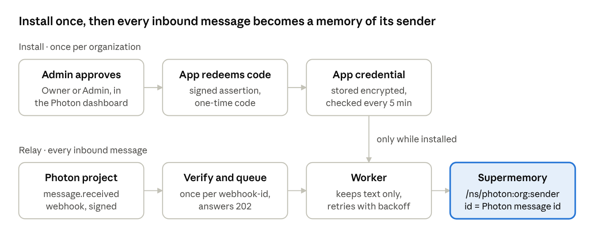

# Proposal: Supermemory × Photon

Nov 7, 2026 · Kelly Guo

We'd like to make Supermemory a one-click App on Photon. An organization admin installs it once, and every inbound message becomes a memory of the person who sent it. Nobody pastes an API key.

## How it works



Each sender gets their own namespace (`photon:<org>:<user>`), and each conversation is a `group`. The Photon message id is the document id, so a retried webhook never adds a duplicate.

## Demo

We have a working prototype, `supermemory-app` (TypeScript, Node 24), running on Photon staging. Install, message relay and uninstall all work. One Photon change (ENG-4010) is left before the App can create its own webhooks. Until then, we set the webhook up by hand.

## Example code

```ts
app.post("/webhooks/photon", async (c) => {
  let event: any;
  try { event = webhook.verify(await c.req.text(), c.req.header()); }
  catch { return c.body(null, 401); }
  const msg = event.data.object;
  if (event.type !== "message.received" || msg.content?.type !== "text") return c.body(null, 204);

  await fetch(`https://api.supermemory.ai/ns/photon:${ORG}:${msg.sentBy.id}/document`, {
    method: "POST",
    headers: { authorization: `Bearer ${SUPERMEMORY_API_KEY}`, "content-type": "application/json" },
    body: JSON.stringify({
      id: `photon:${msg.id}`,
      content: msg.content.text,
      group: { conversation: msg.space.id },
      taskType: "memory",
    }),
  });
  return c.body(null, 202);
});
```

## Next steps

- Your feedback on the namespace and group model, and the recommended way to search a sender's memories before an agent replies.
- Decide who runs the App: Supermemory or Photon.
- A 30-minute demo call, then a pilot with one design partner.
